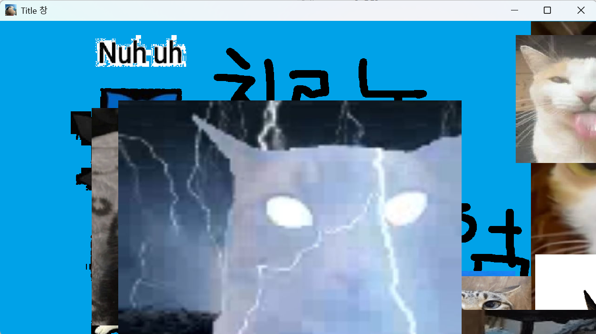
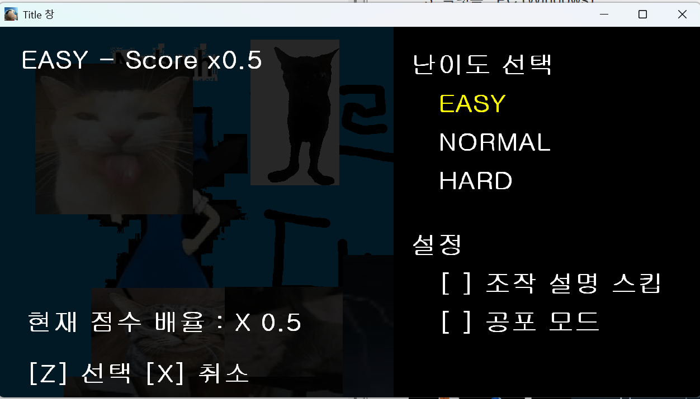
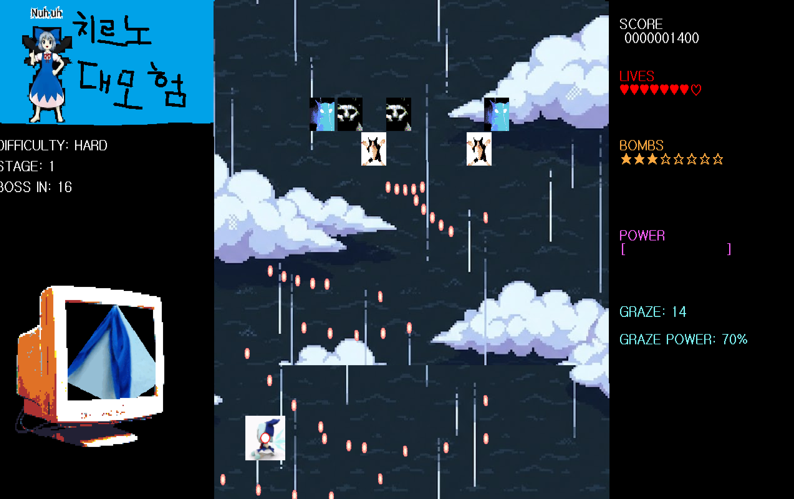
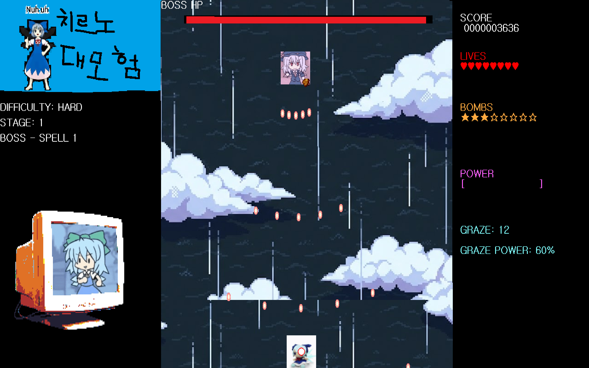
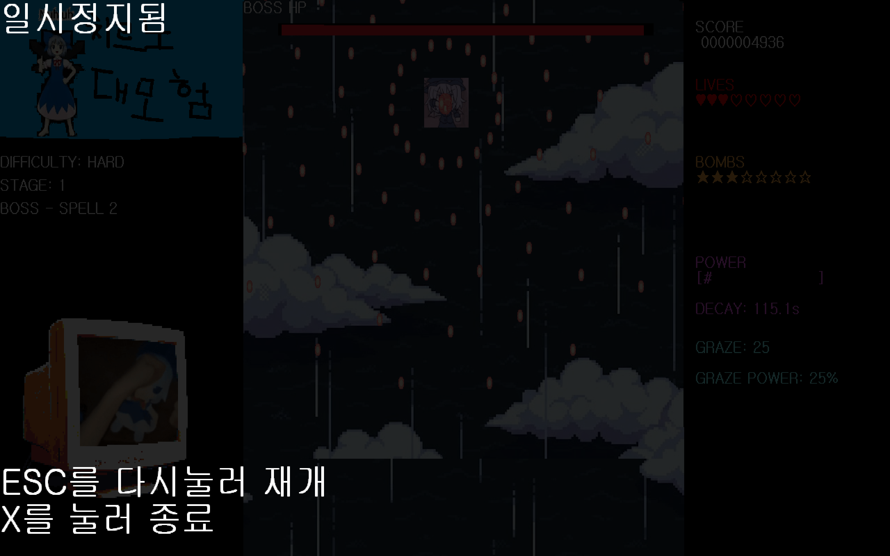
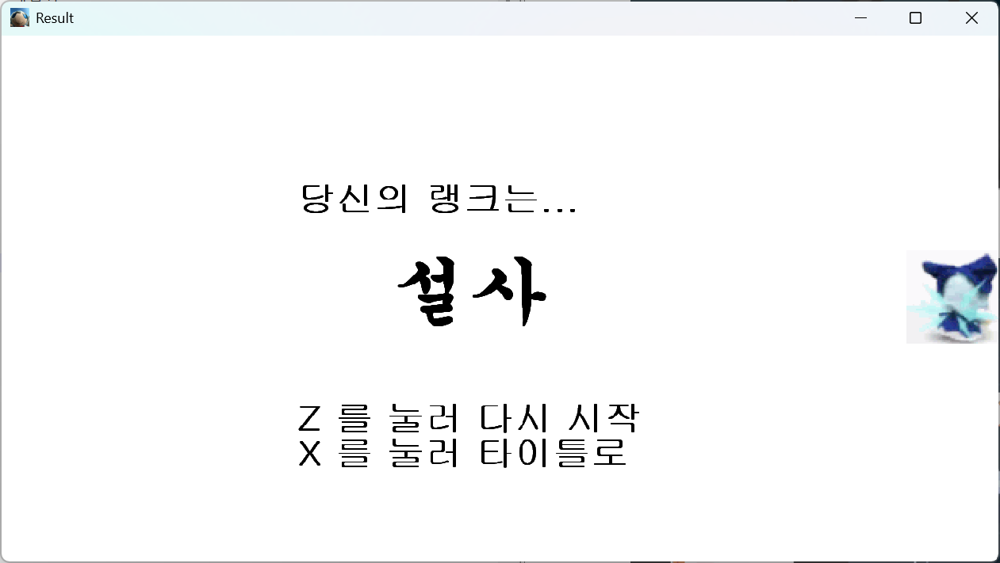

# 26311006_ChaeHyoSeok_GameCraft
- 작성자 : 채효석
- 작성일 : 2026.10.16

## 내용
### 문서 : 
1. [게임 기획서 ](./_doc/PLAN.md )

### 게임 개요 : 
1. 게임명 : 치르노 대모험
2. 장르 : 2D 종스크롤 탄막 슈팅 (Danmaku) 동방 프로젝트 라이크
3. 플랫폼 : PC (Windows)
4. 개발 환경: C/C++ - glc2d 라이브러리 기반 자체 프레임워크 
5. 래퍼런스 : 동방 프로젝트

#### 차후 목표 :
itch.io 에 게임 업로드....

### 게임 화면 예시 :

- 타이틀 화면 :
	

	

- 인게임 화면 :
	
	
	
	
	
	
- 결과 화면 :
	
